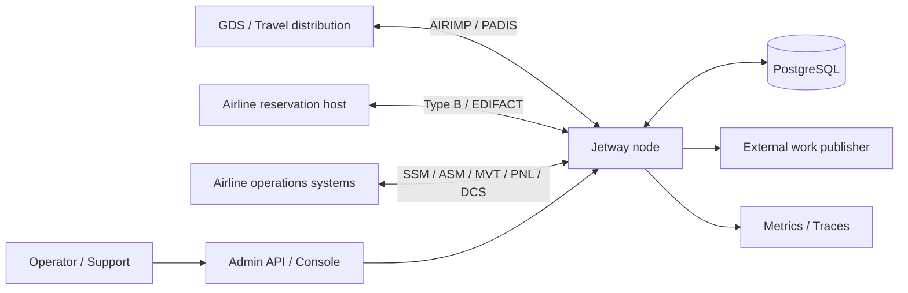

# 01 — System Context

## 1. Purpose

Jetway is an open-source airline and Global Distribution System (GDS) messaging gateway. It connects reservation and operational systems that exchange aviation messages over different wire protocols and transports. It preserves original traffic, interprets supported message types, applies reservation changes to a canonical Passenger Name Record (PNR), routes messages to peers, and produces protocol-appropriate responses.

The system is designed as an embeddable Go library as well as a runnable node. The same assembly in `pkg/node` is used by the daemon and end-to-end scenario suite.

## 2. Stakeholders and external actors

| Actor | Responsibility / interaction |
|---|---|
| Airline reservation host | Sends and receives availability, booking, cancellation and ticket-control messages |
| GDS / travel distribution system | Sends booking and servicing requests to multiple carriers |
| Carrier peer | Connects through a configured link and exchanges messages |
| Airline operations systems | Consume or produce schedule, movement, passenger-list, baggage and DCS messages |
| Operations/support staff | Inspect records, message history, queues, health and metrics |
| Platform operator | Configures peers, transports, secrets, database and deployment |
| External queue publisher | Receives notifications for work persisted in Jetway |
| PostgreSQL | Durable system of record for messages, PNR projections/events and work queues |

Peer identity is established by transport context (certificate, source network or dedicated listener), not by trusting a sender-supplied identity in the message payload.

## 3. System boundary

### Inside Jetway

- Protocol framing and parsing for supported aviation formats.
- Peer identification, message capture, classification, decoding and deduplication.
- Canonical PNR state and event history.
- Reservation gateway logic, response generation and address-based fan-out.
- Availability and inventory simulation/default seams.
- Operational queues, ticket-control and schedule-change workflows.
- Ingress/egress adapters, configuration, metrics and tracing.
- Administrative/API and console surfaces included in the repository.

### Outside Jetway

- Carrier/GDS source-of-truth systems and their bilateral business rules.
- Passenger-facing shopping and booking user experience.
- Real airline inventory and revenue-management authority when integrated through a production responder.
- External identity provider, secrets manager, key management and enterprise authorization.
- Physical network, partner circuits and third-party delivery guarantees.
- Regulatory authority and authoritative paid protocol publications.

## 4. Core capabilities

1. **Interoperability:** normalize supported wire syntax while retaining link-specific profiles.
2. **Durable capture:** retain original inbound bytes and digest before parsing or acknowledgement.
3. **Reservation state:** resolve PNRs, apply changes with optimistic concurrency and retain causal events.
4. **Reliable delivery:** route replies and fan-out messages, retry outbound delivery and recover after restart.
5. **Operational work:** create idempotent queue items for state transitions and time-based deadlines.
6. **Airline domain modules:** support schedule, inventory, fares, ticketing, DCS, baggage, crew, settlement and other aviation message domains.
7. **Operability:** expose health, readiness, metrics, traces, administrative export and retention operations.

## 5. Primary use cases

| Use case | Result |
|---|---|
| Receive a reservation message | Raw message is durably captured, decoded and applied to the appropriate PNR |
| Request availability | Gateway responder returns segment-level status based on configured inventory source |
| Book or service an itinerary | PNR state and events are updated; responses and downstream messages are generated |
| Receive partner response | Partner-specific status is reconciled against the canonical record |
| Relay a multi-address message | Unchanged bytes are delivered to each configured addressee except the ingress peer |
| Handle partner timeout/deadline | Sweeper places actionable work into the queue |
| Diagnose malformed traffic | Raw bytes, digest and decoder diagnostics remain available for replay and audit |
| Onboard a carrier | Operator configures peer, listener, framing, identity and optional message profile |

## 6. Scope exclusions

Jetway is not:
- a passenger-facing booking website, travel agent desktop or customer relationship management product;
- a flight planning, crew pairing/rostering or aircraft maintenance system;
- a complete revenue accounting system;
- an ATPCO fare filing platform;
- a claim of full ONE Order implementation.

Some domain packages are functional modules or simulators and should not be mistaken for a production airline's authoritative system.

## 7. Quality attributes

| Attribute | Design response |
|---|---|
| Durability | Capture-before-decode and persistent store/spool |
| Correctness | Canonical model, event causality, optimistic concurrency, conformance tests |
| Interoperability | Syntax/grammar separation and per-link profiles |
| Recoverability | Raw-message replay, dead-letter retention and outbound retry |
| Security | Transport-derived peer identity, bounded parsers, redaction; encryption/erasure remain gaps |
| Scalability | Stateless HTTP paths where possible; pin stateful carrier links; tune PostgreSQL |
| Observability | Prometheus metrics, OpenTelemetry traces and operational message records |
| Extensibility | Codec packages and integration interfaces are independently importable |

## 8. Context diagram

## 9. Assumptions and dependencies

- Each partner's interface control document is required to validate its dialect and transport details.
- The canonical model is shared across message formats; wire-specific details remain in protocol packages.
- Production data protection requires controls beyond those currently implemented. See [08-security-and-privacy.md](08-security-and-privacy.md).
- The exact feature and conformance level is determined by the code and tests, not by the package name alone.
