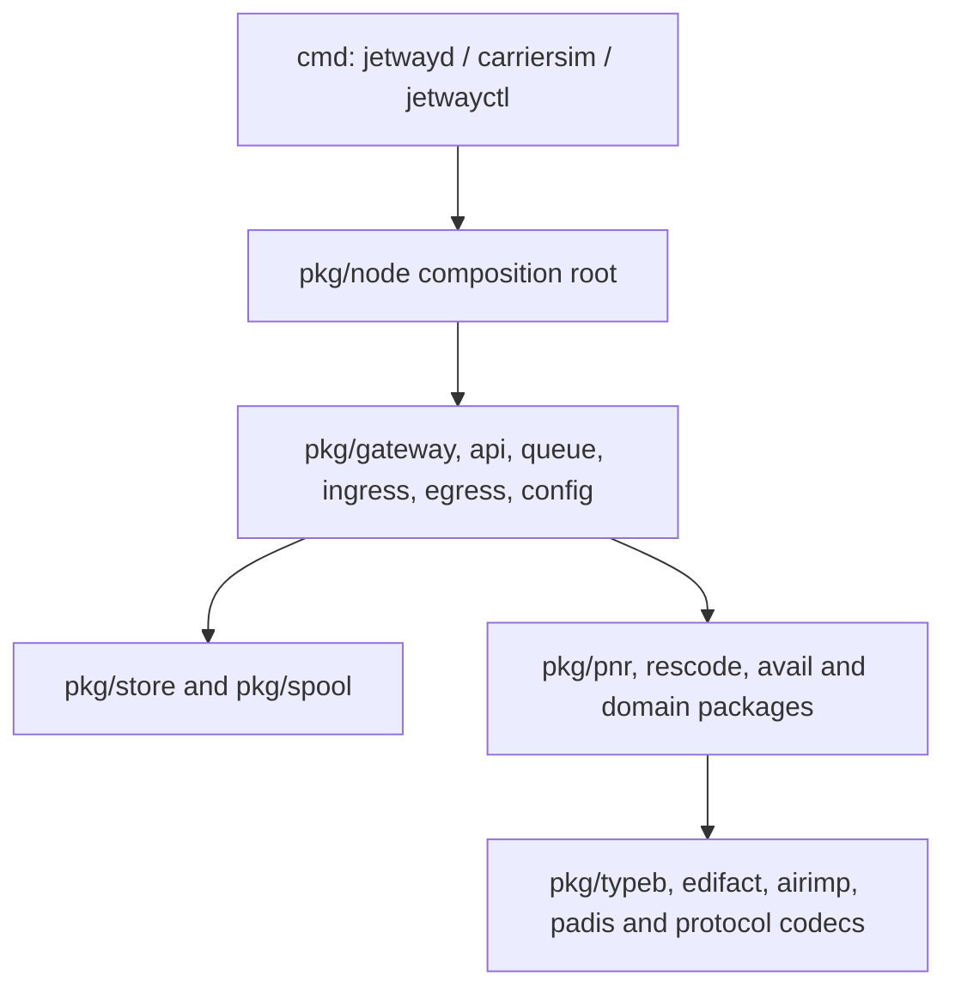

# 02 — Architecture and Component Design

## 1. Architectural style

Jetway is a modular, layered Go application with protocol codecs, application services, adapters and a composition root. It is not a collection of independently deployed microservices. A process can host one gateway or multiple gateway assemblies through the library APIs.

The main separation is:

- **Wire syntax:** framing and universal syntax rules.
- **Message grammar/profile:** carrier- and message-specific interpretation.
- **Canonical domain:** PNR, segment and shared reservation status concepts.
- **Application orchestration:** ingest, apply, respond, route and queue.
- **Infrastructure adapters:** storage, network transports, spool, metrics and configuration.

## 2. Runtime component map

| Component | Main packages / command | Responsibility |
|---|---|---|
| Daemon entry point | `cmd/jetwayd` | Loads configuration and starts a node |
| Node composition | `pkg/node` | Wires gateway, store, ingress, egress, API and telemetry |
| Gateway | `pkg/gateway` | Coordinates inbound processing, reservation behaviour, routing and responses |
| Codecs | `pkg/typeb`, `pkg/edifact`, `pkg/airimp`, `pkg/padis`, etc. | Parse/encode protocol syntax and message profiles |
| Canonical reservation | `pkg/pnr`, `pkg/rescode`, `pkg/avail` | Shared model, date/locator logic, status vocabulary and availability |
| Persistence | `pkg/store` | Message log, PNR state/events, queue and lookup contracts |
| Ingress | `pkg/ingress` | HTTPS, TCP/MATIP and file-drop listeners |
| Egress | `pkg/egress` | Outbound send, retries, peer sessions and file delivery |
| Transport | `pkg/transport`, `pkg/matip` | Framing and session mechanics |
| Spool | `pkg/spool` | Durable inbound write-ahead buffer |
| Work queue | `pkg/queue` | Work placement, time sweeper and external publisher seam |
| API | `pkg/api` | Health, readiness, operational/admin API and console |
| Configuration | `pkg/config` | YAML/env configuration and validation |
| Observability | `pkg/metrics`, `pkg/telemetry` | Prometheus and OpenTelemetry export |

Other domain packages provide schedule, ticketing, DCS, baggage, crew, settlement, ATFM and related aviation formats. See repository README for the full package catalogue.

## 3. Layering and dependency rules

Codec packages are independently importable and do not depend on gateway, store or transport. The canonical model is the shared seam between protocols. Application packages compose codecs with domain services and infrastructure.

The diagram is conceptual: individual packages have more specific imports. In particular, `pkg/matip` is a transport implementation and depends on transport mechanics.

## 4. Inbound pipeline contract

`gateway.Ingest` enforces the ordered pipeline:

1. Identify the peer from trusted transport context.
2. Capture raw bytes and digest durably.
3. Classify by message content rather than blindly trusting link configuration.
4. Decode syntax, then the configured message profile; collect diagnostics.
5. Deduplicate using sender reference where available, otherwise origin/time/digest rules.
6. Apply the message to the PNR with version checking.
7. Place work when a relevant state transition occurs.
8. Record response decision before sending the response.

A post-capture failure is retained for dead-letter handling. Unknown message content is preserved rather than discarded.

## 5. Core architecture decisions

| Decision | Rationale |
|---|---|
| Capture before decode | Preserves evidence and enables replay after decoder fixes |
| Separate syntax from message grammar | Universal syntax is stable; carrier message composition varies |
| Canonical PNR model | Prevents protocol-specific copies of reservation truth |
| Event-linked projections | Explains which inbound message caused each state change |
| Optimistic concurrency | Prevents concurrent agent/partner writes from silently overwriting each other |
| Store queue state internally | Worklist listing, filtering and audit require database semantics |
| Publish after queue persistence | External notification failure must not erase recorded work |
| Address-based fan-out | Multi-addressee Type B messages must reach every addressed peer |
| Pin stateful links | MATIP sessions and channel sequence state cannot be round-robin distributed |

## 6. Integration interfaces

The architecture uses replaceable interfaces at important boundaries:

| Boundary | Interface / seam | Default implementation |
|---|---|---|
| Reservation response / inventory | `gateway.Responder` | `gateway.Inventory` simulator |
| Persistence | `store.Store` | memory or PostgreSQL |
| Inbound transport | `ingress.Ingress` | HTTPS, TCP, file drop |
| Outbound delivery | `egress.Sender` | post, dial, reply-in-session, file drop |
| Framing | `transport.Framer` | configured length-prefix or sentinel |
| AIRIMP dialect | `airimp.Profile` | default recognizer profile |
| PADIS dialect | `padis.Profile` | default segment-handler profile |
| External queue notification | `queue.Publisher` | optional publisher |

## 7. Process topology

A production deployment normally consists of a small number of gateway processes sharing PostgreSQL. Each process owns a defined set of stateful carrier links. HTTP endpoints can sit behind a conventional load balancer; MATIP and framed TCP links require affinity or static assignment.

## 8. Failure domains

- **Database unavailable:** spool/capture durability and readiness determine whether the node can safely accept traffic; never acknowledge a message that has not been durably captured.
- **Decoder/profile error:** retain bytes and diagnostics; fix profile and replay.
- **Partner unavailable:** outbound retry/recovery; do not mark undelivered as delivered.
- **Publisher unavailable:** queue item remains persisted; publisher error is logged.
- **Process failure:** peers reconnect; unacknowledged messages may be retransmitted and deduplicated.
- **Bad configuration:** fail startup/validation rather than silently assigning unknown traffic to a peer.

## 9. Architecture constraints

The in-memory store serializes through a mutex and is for tests/demo, not the production performance path. Multi-process correctness must account for in-memory availability cache and channel sequence baselines. Do not scale MATIP by distributing individual messages across nodes.
