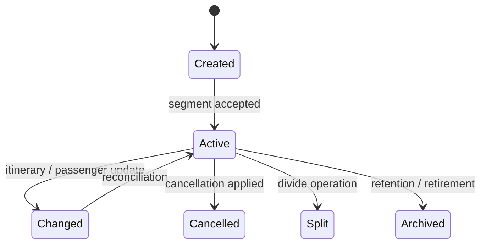

# 03 — Domain Model and Business Rules

## 1. Domain overview

The central business aggregate is the Passenger Name Record (PNR). It represents an itinerary and its passenger/reservation state as understood by this Jetway node. Airline messages are the evidence and commands that change this state. The PNR projection is stored alongside its event history.

## 2. Core concepts

| Concept | Meaning | Important behaviour |
|---|---|---|
| PNR | Canonical reservation record | Identified by Jetway record locator; versioned |
| Record locator | Human-readable booking reference | Allocated by keyed Feistel permutation over the 32⁶ code space |
| Passenger | Person attached to a reservation | Sensitive identity/document attributes require redaction |
| Segment | Flight/transport leg in itinerary | Holds carrier, flight, date, route and reservation status |
| Partner locator | External carrier/GDS reference | Used to reconcile a partner's view with Jetway's record |
| PNR event | State transition caused by a message or action | Links back to the causative message |
| Message | Original inbound/outbound wire record | Raw bytes, digest, metadata and processing result |
| Queue item | Human/automated work item | Idempotent key includes queue, record, reason and segment |
| Availability | Sellable seat/status snapshot | Has provenance and age; not equivalent to authoritative carrier inventory |
| Coupon / ticket | Ticket document and coupon status | Status vocabulary shared across protocol paths |

## 3. PNR lifecycle (conceptual)



This diagram is conceptual rather than a complete enum of implementation statuses. Actual transitions are determined by the PNR and gateway code paths.

## 4. Event sourcing and projection

The event table is the historical record; the PNR state is a materialized projection for efficient reads. Every event names the message that caused it. This provides a causal audit trail for interline reconciliation.

A state-changing write supplies the version originally read. If the stored version has moved, the store returns a conflict. The gateway re-reads and reapplies a bounded number of times.

```text
Inbound message
  -> decoded domain command
  -> read PNR(version = n)
  -> validate/apply -> events
  -> conditional update(expected version n)
       -> success: projection version n+1
       -> conflict: re-read and re-apply
```

Do not implement blind last-write-wins updates: a concurrent schedule change and agent edit must not overwrite one another.

## 5. Date resolution

Airline message dates commonly omit the year (for example, day and month only). `pnr.ResolveDate` resolves against the time the message was received, not the current replay time. This makes historical replay deterministic. An invalid 29 February in a non-leap year is rejected instead of silently shifted to 1 March.

Persist or carry the message-received timestamp as the reference for date interpretation.

## 6. Record locator allocation

The locator allocator uses a keyed Feistel network over the 32⁶ locator space. As a permutation, it maps distinct counter values to distinct locators without a database lookup/retry loop. The output order does not reveal allocation order. The alphabet omits easily confused characters `I`, `O`, `0` and `1`.

Operational invariant: `JETWAY_LOCATOR_SECRET` must remain stable across restarts and deployments. Changing it remaps the code space and can eventually produce a locator already assigned under the old key. Treat an ephemeral generated secret as a production blocker.

## 7. Shared reservation status vocabulary

`pkg/rescode` centralizes the action/status vocabulary shared by Type B/AIRIMP and EDIFACT/PADIS representations. Do not duplicate or independently reinterpret codes in each decoder. Inconsistent meanings would cause the carrier and gateway to disagree about the same booking.

## 8. Queue domain rules

Two independent producers place queue items:

- **Gateway transition producer:** when a partner response changes a segment into a state requiring action.
- **Time sweeper:** when time passes a deadline or a partner has not responded. These conditions cannot be inferred from a message that never arrives.

Placement is idempotent on `(queue, record, reason code, segment)`. Segment 0 is used for record-level work. Working an item changes its status; it is not deleted, preserving who cleared it and when.

## 9. Sensitive domain attributes

SSR `DOCS`, `DOCA`, `DOCO` and `FOID` may contain passport, address, visa or identity details. The PNR redaction method strips sensitive attributes from logs and views not entitled to see them. Raw messages also contain the original values, so projection redaction alone does not protect stored data.

## 10. Invariants

1. Every accepted inbound message is captured before it is interpreted or acknowledged.
2. A PNR mutation is version-checked.
3. Each event is traceable to its causative message.
4. A replay uses the original receive time for date resolution.
5. Locator allocation uses a stable secret.
6. Queue placement is idempotent and work history is retained.
7. Protocol-specific status representations map to one shared vocabulary.
8. Unknown or malformed message content is retained for diagnosis, not silently discarded.

## 11. Domain boundaries

The PNR is not a complete airline operational database. Inventory, fares, ticketing, DCS, crew, baggage and settlement are distinct domain modules or replaceable seams. Their presence in the repository does not imply that Jetway replaces every authoritative enterprise system.
