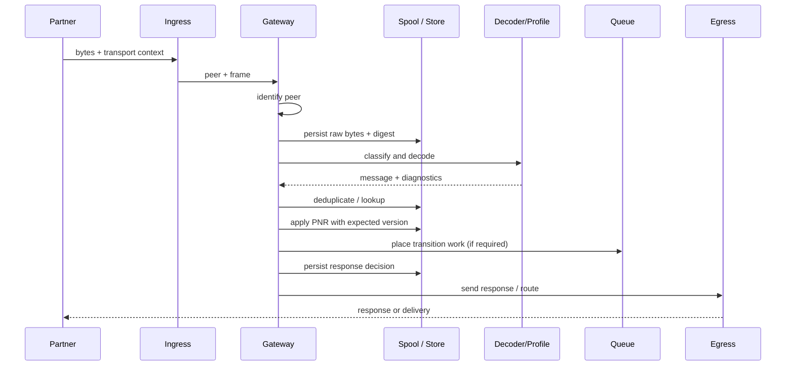

# 04 — Message Lifecycle and Processing Design

## 1. Overview

All inbound messages follow one ordered pipeline. The order is a correctness contract, not an implementation convenience. The pipeline is orchestrated by `pkg/gateway`.

## 2. End-to-end sequence

## 3. Pipeline stages

| Stage | Input | Processing | Output / failure behaviour |
|---|---|---|---|
| 0. Identify | Bytes and transport context | Resolve peer by certificate, source network or dedicated listener | Unknown/unmapped identity is refused |
| 1. Capture | Identified peer and raw bytes | Persist bytes and digest; spool may decouple acknowledgement from DB availability | Durable message evidence |
| 2. Classify | Raw content | Detect actual wire/message family | Prevent wrong configured decoder from mangling traffic |
| 3. Decode | Raw bytes + profile | Parse universal syntax, then message grammar; accumulate diagnostics | Parsed message or preserved unknown payload |
| 4. Dedupe | Sender reference or origin/time/digest | Detect duplicate/retransmission | Duplicate classification; PDM retransmission distinguished |
| 5. Apply | Domain message | Resolve PNR, fold changes, write events with expected version | New projection or bounded conflict retry |
| 6. Queue | Before/after segment state | Place work on qualifying transition | Idempotent queue item |
| 7. Respond | Message class and domain result | Decide and persist response before delivery | Answer consistent with recorded state |

A failure after capture must retain original bytes and the reason in dead-letter handling. A failed message is not marked successful and is not dropped.

## 4. Capture and acknowledgement

The raw payload and digest are captured before parsing. This is required because carrier dialects change and decoders can be incomplete or wrong. Capture enables:

- replay after a parser/profile fix;
- audit of exactly what the partner transmitted;
- safe failure without losing the only copy of a booking instruction.

The transport must not acknowledge a message as accepted until the configured durability contract has been met. When the spool is enabled, it acts as a durable write-ahead buffer.

## 5. Deduplication

Use the strongest sender-provided identity available:
- EDIFACT interchange control reference where applicable;
- for Type B messages without an equivalent sender reference, combine originator, time group and digest;
- recognize PDM-marked Type B retransmissions as retransmissions rather than new business divergence.

Dedupe is a processing guarantee, not a reason to discard the raw record. Retain enough metadata to explain why a message was treated as duplicate.

## 6. Applying state and concurrency

The pipeline reads a PNR and remembers its version, applies domain changes and submits the expected version with generated events. On conflict, it re-reads and reapplies, up to a bounded retry count. Exhausted retries must surface as a processing failure and remain diagnosable.

## 7. Queue trigger semantics

Queue work is created from a transition, not merely from the final state. Example: if a partner confirms a segment, create a work item for that transition; a later unrelated message touching the already-confirmed PNR must not create the same item again.

The sweeper handles conditions with no inbound event, such as missed partner response and ticketing deadline expiry.

## 8. Response and outbound delivery

For message classes that expect a response, record the response decision on the local record before sending it. This avoids a state where the partner receives an answer that contradicts the local record.

Outbound delivery is handled through egress adapters. Delivery failure is retried with recovery state; it must not be represented as successful delivery. Where a partner connection is bidirectional, reply-in-session can reuse the existing session.

## 9. Fan-out and relay

Routing by peer name is appropriate for a reply to the sender. Routing by address is required for a message with multiple addressees. Fan-out resolves each Type B address against peer `TTYAddress` and `Addresses`, sends the original bytes unchanged and records per-addressee outcome.

Relay is disabled by default. A relay must not forward a message back to the ingress peer; otherwise store-and-forward loops can persist across restarts.

## 10. Replay and dead-letter handling

Replay must use captured bytes, original receive timestamp, original peer context and a controlled decoder/profile version. Replay should be auditable and idempotent. Never re-encode a non-conforming raw message for audit: parsed/normalized representation may not preserve original whitespace or exact bytes.

## 11. Operational states

At minimum, operators need to distinguish captured, decoded, duplicate, applied, response-pending/delivered, dead-lettered and replayed states. Exact enum names should follow the implementation. The message record is the durable evidence; logs are not the system of record.
