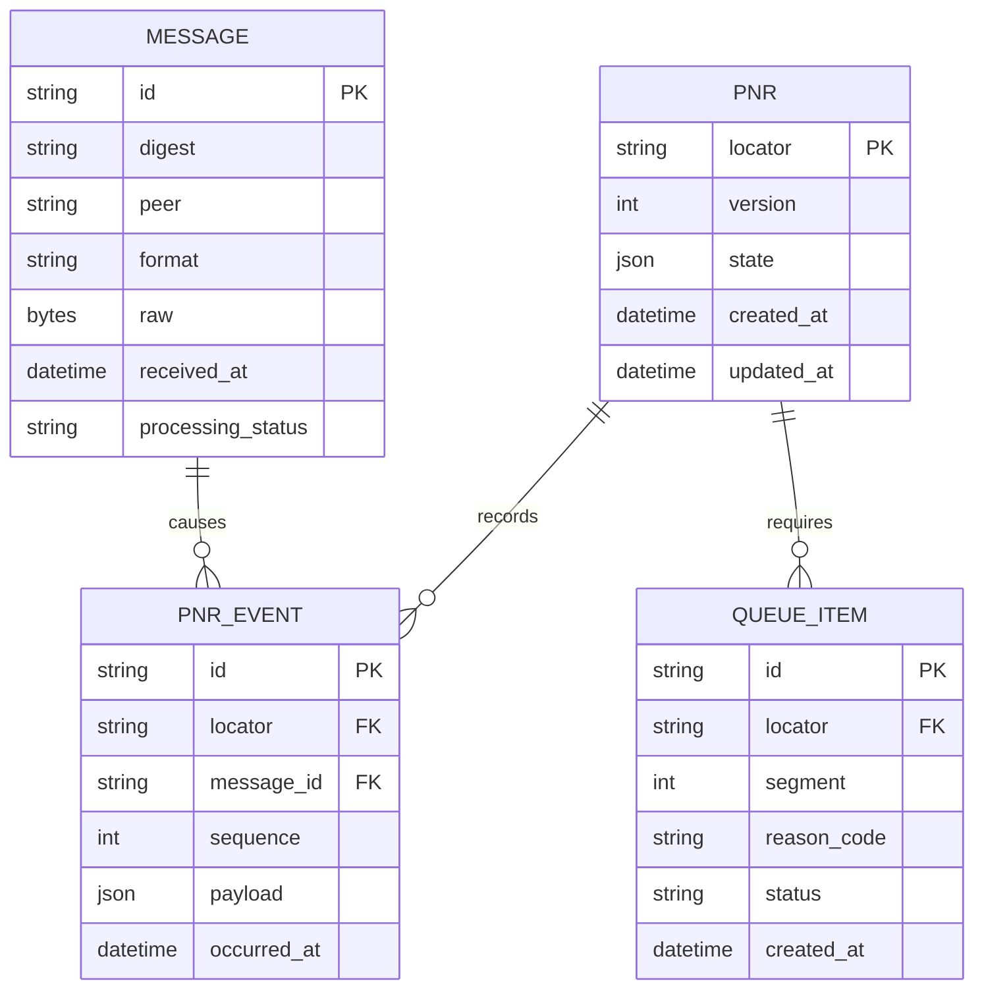

# 06 — Data Architecture and Persistence

## 1. Persistence responsibilities

Jetway persistence has several distinct responsibilities:
- append-only storage of raw inbound/outbound messages;
- PNR state projection for efficient reads;
- PNR event history for causality and audit;
- queue state and work history;
- deduplication and lookup support;
- durable spool buffering and replay.

The in-memory and PostgreSQL stores implement shared contracts. The memory backend is primarily for tests and demos.

## 2. Logical data model

This is a conceptual view, not a literal schema migration. The embedded PostgreSQL schema and store implementation are authoritative for column names and indexes.

## 3. Store contract

The store exposes operations for message append/read, PNR create/get/update, indexed lookup and queue work. Updates are conditional on the version read by the caller. A conflict is explicit; callers must re-read and reapply.

A lookup contract must search the full relevant dataset or return an error. Returning a prefix of recent records as if it were a complete search is incorrect. Postgres uses a GIN index on the PNR state projection for document, partner locator and flight/date containment lookups.

## 4. Event and projection write

A successful PNR update persists generated events and the updated projection as one logical operation. Events reference the causative message. The projection is a read optimization; the event history explains how it came to be.

## 5. Message capture and spool

Raw message capture includes original bytes and a digest. The spool is a durable write-ahead buffer that allows inbound capture to be separated from database processing. The spool is currently unbounded and draining is serial; both are operational limitations requiring disk monitoring and capacity safeguards.

## 6. PostgreSQL considerations

The workload is write-heavy OLTP. Every message is an insert and many are followed by PNR reads/writes. Preserve synchronous commit for the durability guarantee. Use a connection pool sized to actual in-flight concurrency; avoid giving every gateway process a large independent pool. PgBouncer in transaction mode may be appropriate for multi-process deployments.

The repository's scaling notes describe benchmark settings and observed rates. Treat those figures as a baseline, not an SLA. Validate with production hardware, partner traffic distribution and the actual schema.

## 7. Indexing and query correctness

Hot-path lookups include document number, external carrier locator and flight/date. These must use complete indexed lookups rather than scanning a limited recent-PNR page. GIN containment narrows candidate rows; shared domain filtering must remove false positives, and pagination must continue until all candidates are read.

Potential future optimization: dedicated btree columns for document number and partner locator. This is an optimization only after correctness is maintained by current lookup behaviour.

## 8. Retention and export

The admin surface supports archive export as newline-delimited JSON and retention/retirement operations. Postgres retirement is day/partition-oriented; the memory store uses a host-supplied pruning policy. Export records before retention removes them and verify the archive independently.

Retention is not equivalent to erasure. A single passenger's data erasure workflow is not currently implemented.

## 9. Consistency and transaction boundaries

- PNR projection and associated events must be consistent.
- Queue placement is persisted before external publisher notification.
- Response decision is persisted before response delivery.
- Raw message capture precedes decode/apply.
- Outbound retry state must survive process restart.
- Deduplication must be shared across processes through the store.

## 10. Backup and recovery

Production deployment must define PostgreSQL backup/PITR, restore testing, WAL retention, archive export and spool-volume recovery. A recovered node must retain the same locator secret and compatible protocol/profile configuration. After restore, reconcile message capture, PNR events, outbound delivery and queue state before resuming partner traffic.

## 11. Data classification

| Data | Classification | Handling |
|---|---|---|
| Raw message bytes | Restricted passenger/partner data | Access restricted; may contain full personal data |
| PNR projection/events | Restricted passenger data | Redact sensitive fields from logs and unauthorized views |
| Locator and carrier codes | Operationally sensitive | Useful for tracing; still require authorization |
| Metrics | Aggregated operational | Never attach passenger names/documents |
| Configuration/secrets | Secret | Protect tokens, TLS keys and locator secret |

Encryption at rest and individual erasure are known gaps. Do not use production passenger data until those gaps are addressed.
