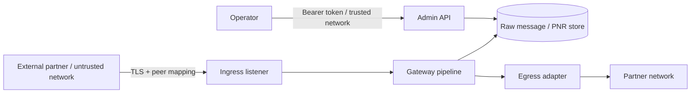

# 08 — Security and Privacy Design

## 1. Security objectives

- Authenticate partner connections using transport-bound identity.
- Prevent unauthorized access to PNRs, raw messages and administrative operations.
- Bound untrusted input and resource consumption.
- Protect passenger personal data in storage, logs, traces and exports.
- Preserve message integrity and delivery evidence.
- Make trust assumptions explicit for every listener and relay.

## 2. Trust boundaries

Never derive peer identity from message body fields. A certificate signed by a trusted CA but not mapped to a configured peer must be rejected.

## 3. Authentication and authorization

- Configure `http.admin_token` for API/console operations that read records or mutate system state.
- Without the token, the API/console may be unauthenticated; disable the console or bind HTTP only to a trusted interface if token protection is not configured.
- Use `require_token: true` for listeners reachable by untrusted clients.
- Prefer mTLS with `tls.client_ca` and certificate-CN peer mapping.
- Use CIDR mapping only on controlled private networks.
- A record locator being hard to guess is not authorization. Every record-access surface must enforce caller permissions.

The current API model is a single bearer token, not per-user identity, roles or a full enterprise authorization system.

## 4. Transport security

Use TLS for partner links where credentials or passenger data cross networks. Tokens sent over cleartext transport can be observed. Configure idle timeout, max connections, rate limit and total rate limit on exposed listeners. Certificate rotation currently requires process restart because certificates are read at startup.

## 5. Passenger personal data

PNR fields and raw messages may contain passenger names, contacts, passport, visa, address and identity document details. SSR `DOCS`, `DOCA`, `DOCO` and `FOID` are flagged sensitive and `PNR.Redacted()` strips them from selected logs/views.

Redaction is not encryption. The raw message log contains the original bytes, including personal data. Database access, backups, exports, spool files and support tooling must therefore be treated as restricted.

## 6. Known security gaps — release blockers

The repository explicitly documents these limitations:

1. **No encryption at rest / field-level encryption.** Sensitive data is stored in plaintext; no key-management workflow exists.
2. **No individual erasure workflow.** Retention/retirement exists but cannot erase one passenger's data across all records and raw messages.
3. **Single bearer-token API auth.** No per-user accounts or granular roles.
4. **Tokenless peer identification may be unsafe on public listeners.** Configure token requirement or certificate identity.
5. **Spool is unbounded.** A prolonged downstream outage can exhaust disk.
6. **Certificate rotation requires restart.**

Do not put production passenger data into a deployment until encryption and erasure are implemented and independently reviewed.

## 7. Secure configuration baseline

- Bind admin HTTP to a trusted interface and set a strong `http.admin_token`.
- Put TLS termination in front of the API or enable native HTTP TLS.
- Configure `tls.client_ca` and explicit certificate-to-peer mappings.
- Enable peer tokens on untrusted listeners and use TLS.
- Set connection, idle and rate limits.
- Keep PostgreSQL private; restrict access to raw message and PNR state columns.
- Set a stable, high-entropy `JETWAY_LOCATOR_SECRET`; store it in a secret manager.
- Restrict filesystem permissions on spool, exports, backups and configuration.
- Never include passenger names, documents or contact details in traces/metrics.
- Audit relay destinations and disable relay unless explicitly required.

## 8. Input hardening already present

The implementation documents bounded EDIFACT segment counts, maximum transport frame size and API body limits; plausible UNA service-character validation; rejection of test interchanges; explicit refusal for unmapped certificates; and fuzz tests for parsers.

## 9. Threat scenarios

| Threat | Control / required response |
|---|---|
| Spoofed peer name | Bind identity to certificate, private CIDR or dedicated listener |
| Credential interception | TLS on token-bearing links |
| Oversized/malformed payload | Frame/body/segment limits and parser fuzzing |
| Unauthorized PNR access | Admin token, network restriction; future per-user authorization |
| Passenger data leakage | Redaction plus future encryption/erasure; restrict raw data access |
| Open relay abuse | Relay off by default; explicit peer allowlist and loop prevention |
| Locator enumeration | Keyed permutation; still enforce authorization |
| Disk exhaustion | Monitor spool and implement bounded spool/backpressure |
| Secret rotation error | Stable locator key and controlled rotation plan |

## 10. Security verification

Security tests should cover unmapped certificates, wrong tokens, expired/invalid TLS, unauthorized API access, payload limits, relay loops, redaction of sensitive SSRs, absence of PII in telemetry and recovery after credential/certificate rotation.
