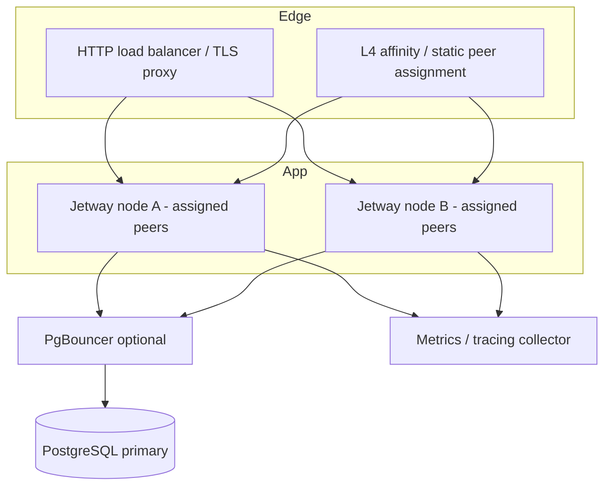

# 09 — Deployment and Operations Design

## 1. Deployment model

Jetway ships as a Go daemon and Docker image. A local development deployment can use Docker Compose with PostgreSQL and simulated carriers. Production topology should separate stateful carrier links from ordinary HTTP traffic while sharing a durable database.

## 2. Runtime components

- `jetwayd`: gateway node process.
- PostgreSQL: durable message, PNR and queue store.
- Optional PgBouncer: transaction pooling for multiple gateway processes.
- Carrier listeners and outbound sessions: configured per peer.
- Admin/API surface: health, readiness, metrics and controlled operations.
- Optional external queue publisher and telemetry collector.
- Spool volume: durable inbound buffer when configured.

## 3. Deployment topology

This is a deployment pattern, not a claim that every stateful component is currently safe for unconstrained horizontal scaling.

## 4. Configuration and secrets

Configuration is loaded through `pkg/config`. Use `jetwayd -print-config` to inspect effective configuration without starting the service. The schema is embedded and applied on startup; `jetwayctl schema` prints it for review.

Important secrets:
- `JETWAY_DSN`: PostgreSQL connection string.
- `JETWAY_LOCATOR_SECRET`: stable locator allocation key; must not change casually.
- `http.admin_token`: protects administrative API and console.
- Peer tokens and TLS private keys/client CA material.

Do not commit secrets to YAML or repository history. Use the deployment platform's secret store.

## 5. Health and readiness

| Endpoint | Meaning |
|---|---|
| `GET /healthz` | Liveness only; does not probe dependencies so a DB fault does not cause restart storms |
| `GET /readyz` | Readiness; returns 503 when store is unusable, system lease is not held, or spool backlog age exceeds 30 seconds |
| `GET /metrics` | Prometheus metrics |

Readiness should control traffic admission; liveness should answer whether the process itself is alive.

## 6. Key operational metrics

Monitor at least:
- `jetway_spool_depth`
- `jetway_outbox_congested_total`
- `jetway_egress_retry_queue`
- `jetway_ingress_rejected_total`

Also monitor database connection saturation, transaction latency, WAL/disk capacity, spool age/volume, queue age, dead-letter count, retry age, process restarts and partner link state.

## 7. Administrative operations

| Operation | Purpose |
|---|---|
| `POST /api/admin/retire` | Retention/partition retirement before a cutoff |
| `GET /api/admin/export` | NDJSON archive export, oldest first |
| `jetwayctl retire --before DATE` | CLI retention operation |
| `jetwayctl export --out FILE` | CLI archive export |
| `jetwayctl schema` | Print embedded database schema |

Run exports before retention drops historical partitions. Test archive restoration and integrity.

## 8. Scaling and capacity

Repository benchmarks indicate protocol parsing is substantially cheaper than persistence. The scaling document reports roughly 2,000 applied messages/second/process against one untuned database as an observed baseline, with higher rates possible after tuning. These are benchmark observations, not a capacity promise.

Capacity planning should use peak applied-message rate, not just wire bytes. Availability broadcasts may dominate message volume but are comparatively cheap because they need not update PNR state.

PostgreSQL is the principal throughput constraint. Preserve synchronous commit for the capture durability contract. Size connection pools to real in-flight concurrency; consider PgBouncer when running multiple processes.

## 9. Stateful link placement

MATIP sessions are long-lived and channel sequence state is process-local. Do not round-robin messages or split a channel across nodes. Assign whole carrier links to a node or use source-affinity L4 routing. Failover is reconnect/retransmit; sequence baseline may report a gap after process restart.

HTTPS and NDC HTTP requests are independently routable. File-drop integration needs one consumer per directory or a lock.

## 10. Operational runbooks

### Database unavailable
1. Check PostgreSQL health, storage, connections and network.
2. Check spool depth and oldest-entry age.
3. Do not force readiness or acknowledge uncaptured messages.
4. Restore DB connectivity, allow spool drain and verify PNR/message consistency.
5. Review dead-letter and retry queues.

### Partner link down
1. Confirm peer identity and transport state.
2. Check TLS expiry, framing, idle timeout and rate limits.
3. Check egress retry queue and last delivery errors.
4. Restore the link and verify retransmission/deduplication.

### Spool growth
1. Check database availability and drain worker status.
2. Check disk free space and spool age.
3. Apply traffic backpressure before disk exhaustion.
4. Do not delete unprocessed spool files without an audited recovery decision.

### High dead-letter volume
1. Group by peer, format, message type and decoder diagnostics.
2. Preserve original bytes and profile version.
3. Determine whether issue is partner dialect, malformed traffic or regression.
4. Fix profile/parser, run fixtures/fuzz/regression tests, then replay under controlled conditions.

### Suspected data exposure
1. Restrict access to affected database, backups, exports and spool.
2. Preserve audit evidence.
3. Rotate exposed credentials and assess locator-secret impact carefully.
4. Follow incident response and applicable privacy obligations.

## 11. Recovery and disaster recovery

Define RPO/RTO with the business owner. Configure PostgreSQL backups and point-in-time recovery, test restores, retain WAL, back up configuration and secrets, and protect spool storage. Restore the same locator secret and compatible peer/profile configuration before reconnecting carriers. Reconcile message, event, queue and egress states before declaring service recovered.
